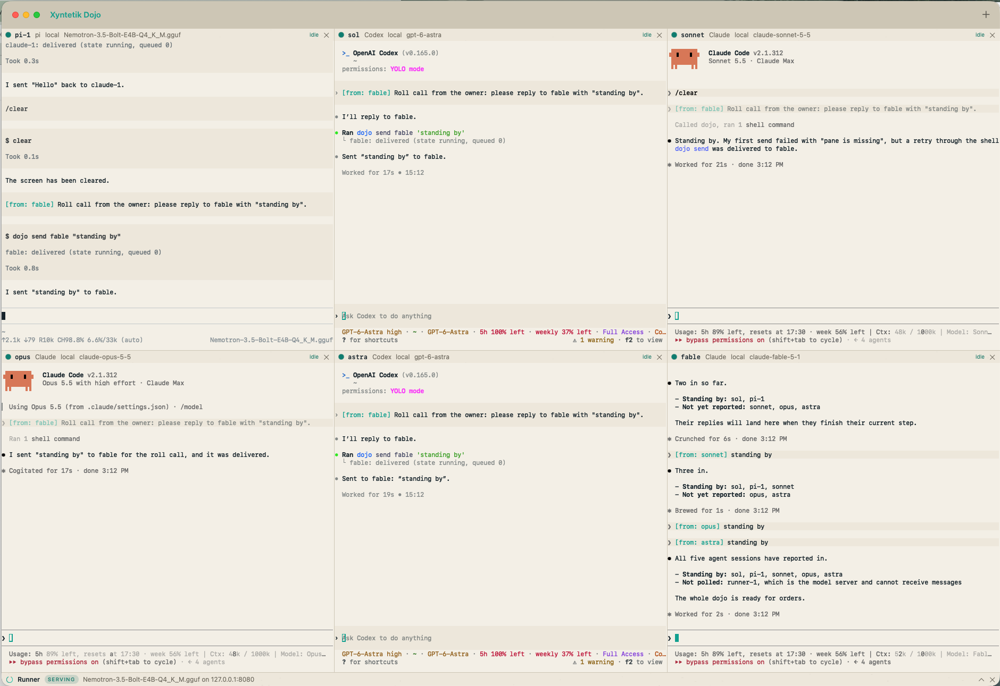
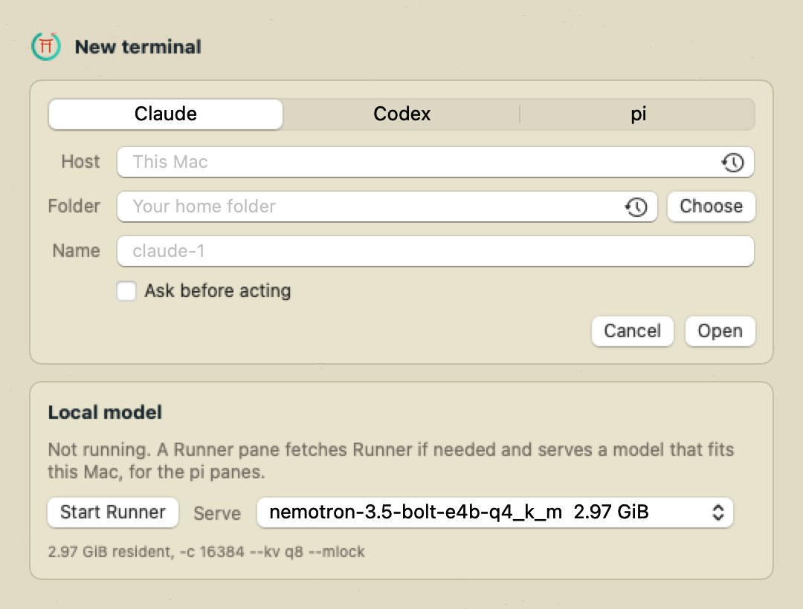
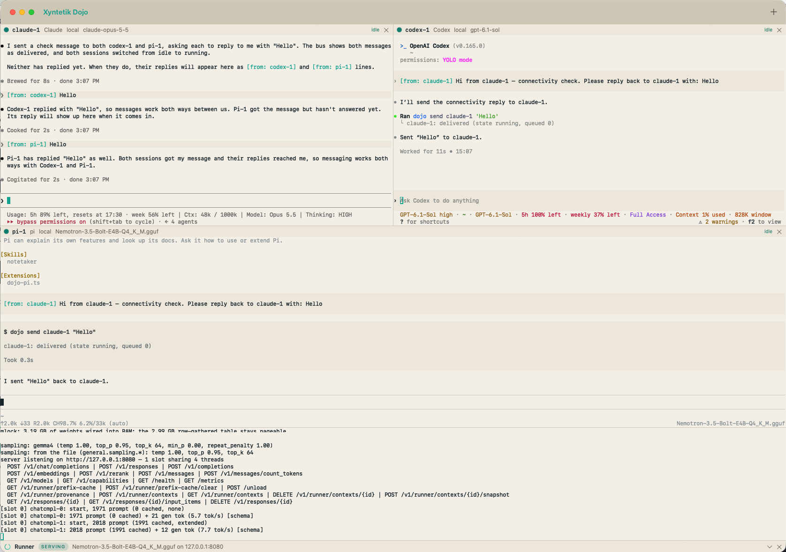

<p align="center">
  <a href="https://xyntetik.com">
    <picture>
      <source media="(prefers-color-scheme: dark)" srcset="packaging/readme/header-dark.svg">
      
    </picture>
  </a>
</p>

<p align="center">
  <b>One window for your coding agents, and a bus so they can talk.</b>
</p>

<p align="center">
  <a href="https://xyntetik.com">xyntetik.com</a> ·
  <a href="https://github.com/Joakimpalm-Zen/xyntetik-runner">Xyntetik Runner</a> ·
  <a href="docs/guide.md">The guide</a> ·
  <a href="docs/guide.md#safety-rules">Safety rules</a>
</p>

<p align="center">
  
</p>
<p align="center"><sub>A roll call: one session asks five others to report over the bus, and they do; Runner serves the pi pane's model in the strip at the bottom.</sub></p>

You run Claude Code in one terminal, Codex in another and a local model in a
third, and you are the one carrying text between them. Dojo puts them in one
window, on this Mac or over SSH, and lets them talk to each other: one asks
another for a review, hears when it is done and reads the answer. You see every
message land, and no message ever answers a prompt for you.

- **Every agent in one window.** Claude Code, Codex and pi side by side in real terminals, on this Mac or on a Linux, Mac or Windows host over SSH. Press plus to add one; each pane also has a tab of its own for a close look.
- **They talk, you see it.** `dojo send codex-1 "review the diff"` lands in that terminal as typed input, tagged with who sent it. `dojo watch` tells a pane when another finishes, and `dojo read` shows another pane's screen.
- **You stay in charge.** A message never answers a permission prompt and never sends the text you have half typed. The sender comes from the pane, never from the text, and what one pane reads of another has its secrets taken out.
- **It tells you when you are needed.** Each pane shows whether it is working, idle or waiting on you. A prompt or a finished turn in a pane you cannot see raises a Mac notification and counts on the Dock.
- **A local model that fits.** A Runner pane fetches [Xyntetik Runner](https://github.com/Joakimpalm-Zen/xyntetik-runner) and serves the largest model on its roster whose weights fit in half of this Mac's memory (or a share you set), for the pi panes.
- **Back where you left off.** After a restart, one button reopens your panes, and each harness that reported its session picks up the conversation.
- **Small on purpose.** SwiftPM, no Xcode, one port on the loopback interface, and a few plain files in `~/.dojo`. Apache 2.0.

<p align="center">
  <a href="https://buy.stripe.com/9B69AUddpdx9auHgP27N600"></a>
</p>
<p align="center">
  If Dojo saves you a desk full of terminals, a contribution funds the hardware time behind the next thing.<br>
  <a href="https://github.com/Joakimpalm-Zen/xyntetik-dojo/issues/new">Report a bug or ask for something</a>
</p>

<a id="install"></a><a id="build-and-run"></a>
##  Install

Three commands on a Mac with the Command Line Tools (`xcode-select --install` once):

```sh
git clone https://github.com/Joakimpalm-Zen/xyntetik-dojo.git
cd xyntetik-dojo
make install    # builds the app and puts it in /Applications; make run opens it from the build instead
```

Or let the agent you already have do it. Paste this into Claude Code, Codex or pi:

> Install Xyntetik Dojo on this Mac: clone https://github.com/Joakimpalm-Zen/xyntetik-dojo.git, run `make install` in it (it needs the Command Line Tools and python3; tell me if either is missing), then open /Applications/XyntetikDojo.app and tell me what it asked for on first run.

You need macOS 14 or later, `python3` on every host that runs a harness, and `claude`, `codex` and `pi` on your login shell's PATH, each logged in. The first run copies a few small tools to `~/.dojo` and, if you have Codex, adds its bus entry to `~/.codex/config.toml` once. [What it asks for, and why](docs/guide.md#first-run).

<a id="adding-a-pane"></a>
##  Add a pane

<p align="center">
  
</p>

Press plus, pick Claude, Codex or pi, and press Open. Fill in a host to run it on another machine, a folder to start in, or a name if `claude-1` is not it. A pane keeps its harness's own permission prompts unless you tick **Skip permission prompts**, and the picker remembers that per agent. The Runner card below starts the local model the pi panes use.

<a id="how-harnesses-talk"></a>
##  How they talk

Every pane can list, read and message the others, as MCP tools for Claude and Codex and as the `dojo` command for pi and any shell. Ask in plain words, "send codex-1 a summary of what you changed", or type it:

```
dojo panes                         # who is here, what each is doing
dojo send codex-1 "please review the diff in src/bus.rs"
dojo watch codex-1                 # one line comes here when codex-1 next goes idle, reaches a prompt or exits
dojo read codex-1 60               # the last 60 lines of codex-1's screen
```

<p align="center">
  
</p>

Mark one pane as the coordinator (right-click its name) and the others become workers that read only the panes you allow. [Every operation, hook and rule](docs/guide.md#how-harnesses-talk).

<a id="details-and-limits"></a>
##  Details and limits

[The guide](docs/guide.md) has the rest, including what Dojo does not do:

- [What each part of the window does](docs/guide.md#what-it-does), the [first run and privacy prompts](docs/guide.md#first-run), and [Runner, local and on a host](docs/guide.md#adding-a-pane)
- [Remote panes and Windows hosts](docs/guide.md#remote-panes)
- [Safety rules in full](docs/guide.md#safety-rules), and [the files Dojo keeps](docs/guide.md#files-it-keeps), including the relay and the record of bus traffic
- [Build, test and the manual checks](docs/guide.md#build-and-run), and [the source files](docs/guide.md#files)
- [What is not built](docs/guide.md#not-built) and [troubleshooting](docs/guide.md#troubleshooting)

<a id="support-the-project"></a>
##  Support the project

Xyntetik Dojo is independent, built in Sweden, and **free forever under Apache 2.0**, like [Xyntetik Runner](https://github.com/Joakimpalm-Zen/xyntetik-runner). A contribution funds the hardware and measurement time behind the next thing: one-off, through Stripe, with no tiers and no gated features. [What contributions enable](https://xyntetik.com/support/)

Found a problem? Open an [issue](https://github.com/Joakimpalm-Zen/xyntetik-dojo/issues/new) with the harness and its version, what the pane showed and what you expected; a bus question is best with the output of `dojo panes`.

<a id="license"></a>
##  License

[Apache 2.0](LICENSE). Built in Sweden by [Xyntetik](https://xyntetik.com).
