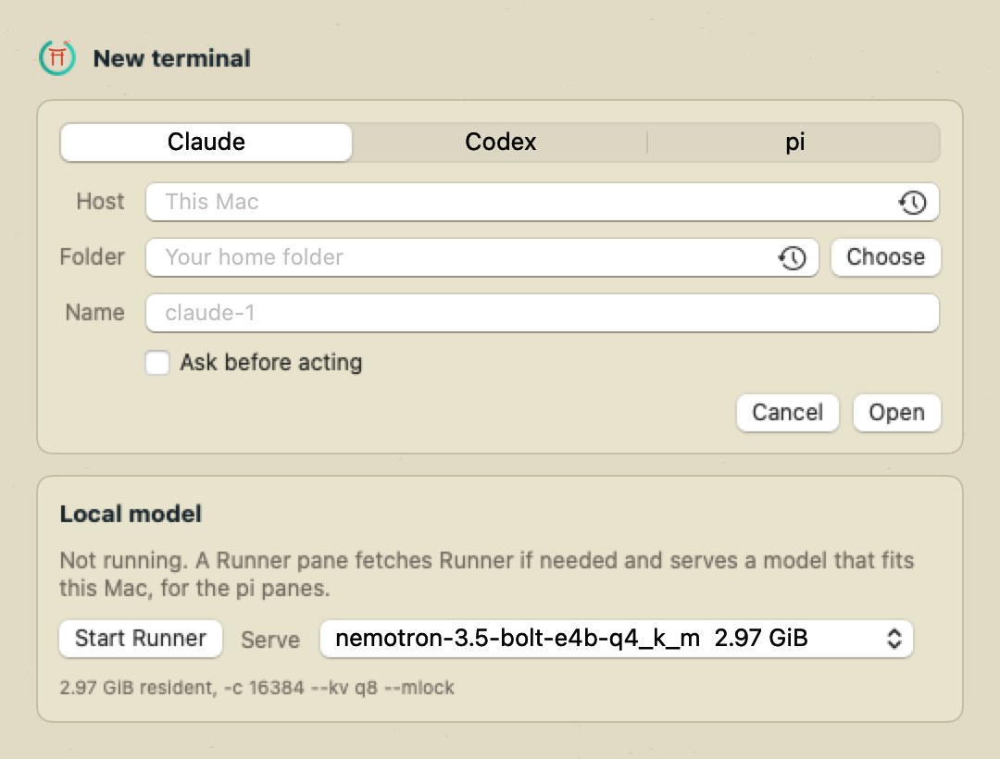
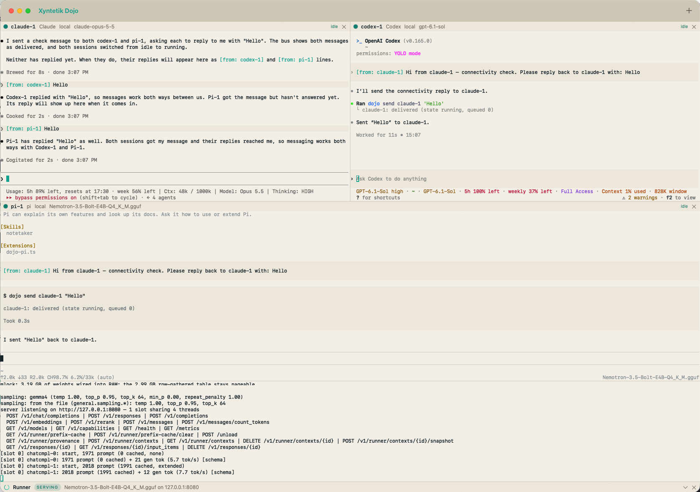

# Xyntetik Dojo: the guide

Everything the [README](../README.md) leaves out: what each part of the window does, how panes start, local and remote, how the harnesses talk and the rules the bus keeps, the files Dojo writes, how to build and test it, what is not built, and what to do when something goes wrong.

**Contents:** [What it does, in detail](#what-it-does) · [Requirements](#requirements) · [First run](#first-run) · [Adding a pane](#adding-a-pane) · [Remote panes](#remote-panes) · [How harnesses talk](#how-harnesses-talk) · [Safety rules](#safety-rules) · [Files it keeps](#files-it-keeps) · [Build and test](#build-and-run) · [Not built](#not-built) · [Source files](#files) · [Troubleshooting](#troubleshooting)

<a id="what-it-does"></a>
## What it does

- One window with a grid of terminals. The plus button (or Cmd-T) adds one: pick Claude, Codex or pi. An optional host makes it remote (a Linux, Mac or Windows box over ssh). An optional folder is where the session starts (a repo root, a book folder); empty means your home folder. Hosts and folders you used before are one click away. An optional name replaces `claude-1`, `codex-1`, `pi-1`; double-click a name in a pane header (or right-click it) to rename the pane later. Drag a pane's header onto another pane and the two swap places. Drop a file or folder from the Finder onto a pane and its path lands in the composer, quoted for the shell, as in Terminal.app. A row of tabs sits above the panes: All is the grid of every pane, and each pane has a tab of its own that fills the window, so the overview and a close look are one click apart. Cmd-1 is All, Cmd-2 to Cmd-9 the first eight panes in order, Cmd-Shift-[ and Cmd-Shift-] step through them. The harness keeps its token, so its messages carry the new name and others reach it by the new name from then on; it was told its old name at launch, so it may still introduce itself by that.
- It looks like a Xyntetik product: the site's colours on a recycled-paper ground (the same by day and night; the system's dark mode does not darken it), the Ensō as the app icon and in the window. The terminals use the ground, the text colour and the sixteen colours of Terminal.app's Novel profile, so a pane is not brighter than a Terminal window beside it. A harness paints with those. The pane changes two things: a white background (the band behind a user message in a light theme) becomes the paper shade, and text under a contrast of 4.5 against its background is darkened just enough to reach it, because half of Novel's colours are made for a darker ground. Claude Code starts with the light theme locally and over SSH, only for that session; the host's saved theme stays as it was. Codex picks its own theme. The icon is drawn by `packaging/make-icon.swift` at build time; no image file is checked in.
- Each pane is a real terminal (SwiftTerm and a pty the pane runs itself, so every byte from the harness passes the pane on its way to the screen). The harness sees an ordinary terminal.
- Panes draw on the GPU (SwiftTerm's Metal renderer), so a harness repainting its whole screen keeps up with a plain terminal.
- After a restart the empty window offers one button that reopens the last panes: kind, host, folder, name and ask-first, each resuming its conversation when the harness reported a session. A pane with no session reopens fresh, and its header says "started fresh" for as long as it is open. So do remote pi panes, and a local pi too old for `--session-id`: they start as they always have. Nothing reopens by itself. Panes you closed by hand are not in the list, and opening a new pane first drops the offer. The list is `~/.dojo/panes.json`, readable only by you; it holds no tokens.
- The terminals use SF Mono Regular at 10.5 points with font smoothing and 15 points between rows. The owner picked it from a sheet of seven standard fonts, each drawn by the app off screen with and without smoothing; change it only from a new sheet of real renders. The half point makes a letter fill its cell: cells snap to whole pixels, and at 11 points every letter would stand about 3% apart on a Retina screen. Cmd-plus, Cmd-minus and Cmd-0 change every pane's text size while the app runs (8 to 24 points); the size is not kept between launches.
- Each pane header shows the name, kind, host, model, queued messages and the state as a mark, also on the tabs: a grey dashed ring starting, a blue triangle running, a green dot idle, an exclamation mark on an orange disc at a prompt, a red ring exited. The pointer on a mark names the state. The pane with the keys has a lighter header with a teal line along its foot, like the selected tab; closing it hands the keys to the pane in its place. A pane at a prompt has a coral ring, and the All tab counts the panes waiting. A turn that finished stays marked on its tab and header until you view the pane: with the app in front, the pane has the keys, so in the grid that takes a click. A prompt or a finish in a pane you cannot see also sends a Mac notification, which opens that pane, and the Dock badge counts what you have not viewed. These come from harness hooks only, once per event, and macOS asks your permission for the notifications and the badge the first time. The panes without the keys sit one step darker, with the bands in them.
- The app runs a bus on `127.0.0.1:7788`. Every harness in the window can call four operations: `panes`, `send`, `read` and `state`.

<a id="requirements"></a>
## Requirements

- macOS 14 or later. Built and tested on macOS 27 (Apple Silicon) with the Swift 6.4 Command Line Tools.
- `python3` on every host that runs a harness (the bus shim uses only the standard library).
- `claude`, `codex` and `pi` on your login shell's PATH, each already logged in.
- For pi: [Xyntetik Runner](https://github.com/Joakimpalm-Zen/xyntetik-runner) serving a model at `http://127.0.0.1:8080/v1`. A Runner pane sets that up (next section); if you already run Runner, or another server that answers `GET /v1/models` on that port (llama-server, for one), pi uses it as it is. The picker names that server, and a Runner pane steps aside while it holds the port.

<a id="first-run"></a>
## First run

On start the app:

1. Copies `tools/dojo-mcp.py`, `tools/dojo-pi.ts` and `tools/runner-start.sh` to `~/.dojo/` and links `~/.dojo/bin/dojo`.
2. If `~/.codex` exists and `~/.codex/config.toml` has no `[mcp_servers.dojo]`, appends the block in `tools/snippets/codex-config.toml`: the dojo MCP server and six state hooks. It does this once and never edits the file again. Delete the block by hand to remove it.

**From Harness Supervisor.** If you ran this app under its earlier name, the first run moves `~/.xhs` to `~/.dojo` (merging folder by folder if `~/.dojo` already exists, keeping any file both have on the new side and saying so) and replaces the `xhs` block in `~/.codex/config.toml` with the `dojo` one, keeping the file as it was beside it as `config.toml.before-dojo`. On an ssh host, run `make remote-setup HOST=...` again.

- **Privacy prompts.** When a harness in a pane reads your Desktop, Documents or Downloads, macOS asks whether the app may, as it does for any terminal app; the first remote pane asks for the local network. With the ad hoc signature `make app` uses by default, every rebuild is a new app to macOS and the questions come back. Run `make cert` once: it makes a self-signed "Xyntetik Dojo" certificate in your login keychain (macOS asks for your password to trust it), and from then on `make app` signs with it and macOS remembers your answers. Or give the app Full Disk Access under System Settings, Privacy & Security, which ends the folder questions altogether.

What needs you, once:

- **Permission prompts, unless you switch them off.** A pane keeps its harness's own permission prompts: Claude asks before it runs a command or edits a file, and Codex keeps its approvals and its sandbox. The bus sees a prompt and holds messages for the pane while it waits. The picker's **Skip permission prompts** box, unticked on a fresh install, runs Claude with `--dangerously-skip-permissions` and Codex with `--yolo` (no approvals, no sandbox). The harness in that pane can then do anything your user can, so keep it to work you would approve anyway. The picker remembers the box for each agent: if that is how you work, tick it once. A pane opened with it says "unrestricted" in its header. pi has no permission prompts of its own, it runs its tools without asking, so a pi pane always says "unrestricted". Panes saved before this box existed reopen the way they ran. A Codex pane also runs with `--dangerously-bypass-hook-trust` either way: that trusts the six dojo state hooks without a `/hooks` confirmation, and lets the model do nothing more.
- **Startup dialogs.** Claude and Codex may show their own first-run dialogs in the pane (folder trust, browser tools, an update offer). Answer them there. A pane turns `idle` when its harness reports that its session started.
- Codex shows two startup warnings: command-line config overrides run it without the shared background server (the app passes the peer rule with `-c developer_instructions`), and `--dangerously-bypass-hook-trust` is on. Both are expected.

<a id="adding-a-pane"></a>
## Adding a pane

<p align="center">
  
</p>

Press plus, pick Claude, Codex or pi, fill in the host, folder and name as you like and press Open (or Return). Tick "Skip permission prompts" for a pane that should act without asking; unticked, the harness asks first (see "What needs you, once" above). The box comes back the way you last left it for that agent. Runner, the local model server, has a card of its own below with its state, its button and the model it serves. Leave the host empty for this Mac. A pane starts in the folder you give (type it, press Choose, or pick a recent one from the clock at the field's edge), or in your home directory. With a host set, the folder is on that host, typed as it is there; Choose and the recent folders are this Mac's, so they step aside. It runs in your login shell (`$SHELL -l -i`), so PATH is the one your terminal has. A pane never inherits `CLAUDE*` variables from the process that opened the app (so `make run` from inside a Claude Code session does not make the pane's Claude a child session). Close a pane with its x button; that ends the harness.

A local pi pane first asks Runner for its models (`GET /v1/models`), starts pi with the first one and shows it in the header. If Runner does not answer, the pane says so and pi is not started.

**Runner.** The picker says whether Runner is serving on this Mac and what. If it is not, add a Runner pane: it runs `tools/runner-start.sh`, which keeps nothing about versions or models of its own:

- The binary is `runner` on your PATH if you have one; else `~/.dojo/runner/runner`, downloaded from the latest release (checked against its `SHA256SUMS`) and replaced when the latest release moves on.
- The models are Runner's own roster, `docs/model-tiers.json` in its repository: the Tier 1 and Tier 2 text models, fetched on every start (a copy is kept for when the network is away). A model admitted there is a candidate here the next time a Runner pane starts; nothing in this app changes.
- Every roster file no larger than this Mac's RAM is asked about with `runner --info fit` on its first 16 MiB. A model fits when the weights that stay resident (the hot set for a Gemma E-series model, whose row-gathered token table is never resident; the whole file otherwise, a mixture of experts included) are within half of the RAM, or the share `DOJO_RUNNER_RAM_SHARE` names in the app's environment (`0.75` for a Mac that runs nothing else: a 69 GB model on 128 GB). All that fit are listed in the pane and in `~/.dojo/runner/fits`, largest resident weights first.
- The pane serves the model you chose, or else the largest that fits, wired into RAM (`--mlock`). Runner's own verdict counts the RAM free right now: the contexts 262144, 131072, 65536, 32768 and 16384 (or the list `DOJO_RUNNER_CONTEXTS` names, less any below 16384) are tried largest first, skipping those above the context the model was trained for (read from its head; Runner would otherwise stretch the model with YaRN), and the first the verdict says fits is served with the cache setting it names; when every one pages, the model is served anyway at context 16384 with a q8 cache and the rest of the machine makes room (what an 8 GB Mac with harnesses open does with Bolt E4B).
- No context below 16384 is served, and a model trained for less is skipped, with the reason in the pane: pi keeps 4096 tokens of the context for itself and its prompt takes about 2000, so a smaller context leaves a pi pane no room to answer (at 4096, every request asks for one token).
- **Choosing.** Once a Runner pane has run on this Mac (the list comes from the last start, which is when the heads are read and `--info fit` asked), the picker's Serve popup lists the models that fit with their resident size, largest first, the one serving or chosen selected and its serve flags under the popup. Pick another and the Runner pane is replaced by one serving it, and that choice is kept in `~/.dojo/runner/model` for later Runner panes (delete the file to go back to the largest that fits).

Runner does not take a place in the grid: it lives in a strip along the bottom of the window, one line with its state (what is being picked or fetched, then the model it serves). Its log opens above the strip while Runner starts, so you see the verdicts and the download, and closes once the server listens; click the strip to open or hide it. The picker follows the same pane and offers one Runner pane per machine: this Mac, and each host. The strip's close button stops Runner. Messages are never sent to a Runner pane.

**Runner on a host.** A model too big for this Mac can run on a host where it fits. Type the host in the picker and press **Start Runner on** that host. The same `runner-start.sh` runs there and picks the model by the host's own RAM, so the host needs the setup below. There it serves on Dojo's own port, `127.0.0.1:18080`, so the host's 8080 stays free for whatever else uses it. That pane's ssh connection also carries the port back to this Mac (`-L <a free port from 18081>:127.0.0.1:18080`), so the tunnel opens and closes with the pane. Runner started over ssh raises no tray, so closing the pane leaves no Runner process behind. To serve one particular roster model instead of the largest that fits (a small one for a first try, say), set `DOJO_RUNNER_MODEL` to its roster id in the host's environment. Each Runner pane has its own strip, which says where it serves: `<model> on <host>`. A pi pane on that host uses it at `127.0.0.1:18080` there; without a Runner pane on that host, it uses the host's own `127.0.0.1:8080`. A pi pane on this Mac uses this Mac's Runner when it answers, and otherwise a host's Runner through its tunnel (`DOJO_RUNNER_URL`, which the pi extension reads). The model is picked by RAM on every machine; a GPU host's offload budget is not consulted.

<a id="remote-panes"></a>
## Remote panes

Set up a host once, with one command from this repository:

```
tar -C tools -cf - dojo-mcp.py dojo-pi.ts runner-start.sh | ssh user@box 'mkdir -p ~/.dojo && tar -C ~/.dojo -xf - && python3 ~/.dojo/dojo-mcp.py install'
```

(`make remote-setup HOST=user@box` runs the same.) It puts the shim, the pi extension and Runner's start script in `~/.dojo` on that host, links `dojo`, and adds the Codex entries there if Codex is installed. Nothing else runs on the remote host.

Then press plus and enter `user@box` as the host (or pick it from the clock at the field's edge once you have used it). The app first asks the host which shell it runs commands in (`ssh host 'echo %OS%'`), then runs:

```
ssh -t -R <the pane's port>:127.0.0.1:7788 -o ServerAliveInterval=30 -o ServerAliveCountMax=3 user@box '<harness in the remote login shell>'
```

The harness runs in the remote login shell (`$SHELL -l -i`), so it needs to be on the PATH that shell sets. The reverse tunnel lets the shim on the remote host reach the bus at that port of `127.0.0.1` there. The remote host's own keys, logins and tokens are used; the app stores none. Use key-based SSH; a password prompt shows up in the pane. A remote pi uses the Runner on that host, which a Runner pane there can start (see Runner on a host above).

### Windows hosts

A Windows host with OpenSSH Server and MSYS2 at `C:\msys64` works the same way. MSYS2 elsewhere (a portable install) is named by `DOJO_MSYS2_BASH`, the full path to its `usr\bin\bash.exe`, in the ssh session's environment: sshd's `SetEnv`, or the user's environment. The probe reads it there. Everything Dojo writes on the host goes under that bash's `$HOME`: Win32-OpenSSH passes the Windows profile (`C:\Users\<you>`) as `HOME` and MSYS2 keeps it, so `~/.dojo` and Runner's files are there unless the host sets `HOME` elsewhere (in an MSYS2 profile script, say). Setup runs `dojo install` with the first of `python` and `python3` that runs, passing over the Microsoft Store stub, which `MSYS2_PATH_TYPE=inherit` can put first on the PATH. The probe sees cmd.exe answer `Windows_NT`, and the pane then runs the same harness command in MSYS2's bash (`bash.exe -l`, with your Windows PATH inherited, so `claude` and `codex` are found where you installed them). The command travels to cmd.exe as base64, so none of its quotes, pipes or percent signs are seen by cmd.exe.

`make remote-setup HOST=user@winbox` detects Windows too. There, `dojo install` writes two small sh scripts in `~/.dojo/bin` instead of a symlink: `dojo`, and a `python3` that runs the Python it was installed with (on Windows, `python3` on PATH is usually the Microsoft Store stub). The harness line puts `~/.dojo/bin` first on PATH, so the MCP shim and hooks find a working `python3`.

Claude Code and Codex both run on a Windows host and reach the bus through the tunnel. A Runner pane there fetches `runner-windows-x86_64.exe` from Runner's release, keeps it as `~/.dojo/runner/runner.exe`, and reads the host's RAM from MSYS2's `/proc/meminfo`. Codex's config hooks call `python3 "$HOME/.dojo/dojo-mcp.py" hook`, which finds the working `python3` in `~/.dojo/bin`.

Each remote pane has its own forward to the bus, on a free port of its host, so closing one leaves the others connected. A keepalive shows a dropped connection within 90 seconds: the pane exits, and if its harness had a session its header has a Reopen button.

<a id="how-harnesses-talk"></a>
## How harnesses talk

The five operations, as MCP tools for Claude and Codex (`mcp__dojo__panes` and so on) and as the `dojo` command for pi and any shell in a pane:

```
dojo panes                         # name, kind, host, state, queued, model; * marks you
dojo send codex-1 "please review the diff in src/bus.rs"
dojo send codex-1 - <<'EOF'              # quotes, backticks, several lines: on stdin, nothing runs
Two things:
1. `make test` fails on main
2. the diff in src/bus.rs
EOF
dojo read claude-1 60              # last 60 lines of claude-1's screen
dojo state pi-1
dojo watch codex-1                 # one line comes here when codex-1 next goes idle, reaches a prompt or exits
dojo send fable --type report repo=xyntetik-dojo pr=92 head=e07bd8a checks=ci=pass,hygiene=pass mergeable=yes
```

Four kinds of message have a typed form: `assign`, `report`, `merged` and `bug`. The bus checks the fields, refuses a message that is wrong with what is wrong, and types a card the other side reads as plain lines; `dojo audit --type report` lists them later. The fields of each are in [the bus note](bus-capabilities.md#typed-messages-d215).

<p align="center">
  
</p>

`watch` replaces waiting and polling. A pane asks once and gets one `[from: codex-1] Bus notice: codex-1 finished its turn.` line, delivered like any message. The notice says it comes from the bus, since the target did not write it, and it says what it rests on: `finished its turn` when a hook reported that, `looks idle` when the screen has been still for 15 seconds but no hook has reported the end of the turn, which may still be going, and `is idle` for a pane with no hook-reported turn. Any of them ends the request; read the pane or watch again, and a real finish after `looks idle` still reaches you. A target that closes ends the request with a line, and so do 12 hours with no news. Remote hosts need `make remote-setup` once for the new command.

`send` types `[from: <your pane>] <text>` into the target terminal and presses Enter, so the target harness gets it as typed input. Ask any harness to do it in plain words: "send codex-1 a summary of what you changed".

| Harness | Bus tools | State | Peer rule |
|---|---|---|---|
| Claude Code | `--mcp-config` at launch | hooks via `--settings` at launch: SessionStart and PostModelSwitch as command hooks (`dojo hook`; Claude Code runs no http hooks for SessionStart; PostModelSwitch carries the new model for the header), http hooks for UserPromptSubmit, PermissionRequest, PostToolUse, Stop, Notification (`permission_prompt`, `idle_prompt`, `agent_needs_input`, `elicitation_dialog`) | `--append-system-prompt` |
| Codex | `[mcp_servers.dojo]` in `~/.codex/config.toml` | command hooks in the same file (`dojo hook`): SessionStart, UserPromptSubmit, PermissionRequest, PostToolUse, Stop, Interrupt | `-c developer_instructions` |
| pi | the `dojo` command (pi has no MCP by design; it runs `dojo` with its bash tool). The pane passes `--tools read,bash,edit,write`, so a `defaultTools` setting of yours cannot leave it without bash, and `--tui-mode fullscreen`, so the composer sits at the bottom of the pane whatever your `tuiMode` setting says | the `dojo-pi.ts` extension: session_start, agent_start, agent_settled, ui_prompt_start, ui_prompt_end | `--append-system-prompt` |

The pi extension also registers Runner as pi's `runner` provider. It observes the editor submission callback to report prompts, built-in commands and shell lines; accepting autocomplete does not release the hold. It tells pi the context the server runs at: Runner's `context_window` from its model list, or for llama.cpp the `n_ctx` on `/props`, then the model's trained context, then 32k; the output limit is a quarter of that, up to 16k. Without this a 262k server was treated as 32k and pi compacted itself until it stuck.

<a id="safety-rules"></a>
## Safety rules

- **A relayed message never answers a prompt.** The bus types into a pane that is `idle` or `running`; a busy harness keeps the input in its own queue and reads it when its current step ends, sooner than the end of its turn. A pane at a permission prompt or question dialog (`prompt`) or not yet started (`starting`) gets the message queued. Whatever has queued goes out as one input, each message on its own line, the moment the pane can take it.
- **Your unsent text is never sent for you.** The bus holds a pane's queue while you have typed into it in the last 3 seconds and while text may be unsent in its composer (the header says "unsent text here"). A terminal cannot tell the app that a composer is empty: Backspace at the start of a line deletes nothing, undo and yank bring text back, a tab becomes spaces. So the hold is one-sided: any key that can put text in the composer turns it on (a character, a paste, a prompt recalled with Up or Down, an editing chord), and it turns off only when the harness itself reports your prompt submitted (its UserPromptSubmit hook; Enter alone is not proof, it can accept a completion and leave the text where it was) or when Ctrl-C empties the composer; deleting and moving change nothing. A stale hold after a character typed and deleted ends with one Ctrl-C. A submission hook that arrives after you started typing the next prompt is for the earlier one and leaves the hold on. In pi, a slash command or a `!` shell line empties the editor without a model turn; the extension reports those too. In a shell pane, which has no hooks, Enter is the submission. The Enter that follows a relayed message is pressed a moment after the text, and not at all if a prompt opened or you typed in that moment. A line inside a message that starts like a `[from: ...]` tag is set in by a space, so only the bus writes a line that begins with one. Keys in the kitty keyboard protocol are read the same way, and the terminal's own answers to the harness (cursor position, colours) count as nobody typing.
- **A fresh Codex pane is ready without a hello.** Codex sends SessionStart with the first prompt, not at startup, so the bus treats a `starting` Codex pane as idle once its screen shows the composer ("Ask Codex to do anything") and has been still for 3 seconds. A Codex startup dialog covers the composer, so the bus does not type into one. Claude and pi announce their start themselves.
- **A lost Stop does not hold messages forever.** A turn can end without a Stop hook (Codex at its usage limit did). A `running` pane whose screen has not changed for 15 seconds is idle again; every harness animates a spinner while it works. A pane at a `prompt` is never timed out.
- **Every message carries its sender.** The sender is taken from the calling pane's token, not from the message text; a `[from: ...]` tag a harness puts at the front of its own text is dropped, so the tag is never doubled or faked. The `[from: <name>]` tag shows in the Xyntetik green wherever a harness paints it: the pane colours it on the way from the harness to the screen.
- **No control characters.** The bus strips escape sequences and other control characters. Where the harness supports bracketed paste, a message arrives as one paste; otherwise line breaks become spaces.
- **The owner comes first.** The bus holds messages for a pane you typed into in the last 3 seconds.
- **Peer messages are not approval.** Each harness is told at launch that `[from: ...]` lines are messages from other sessions, to weigh as information and never as the owner's approval.
- **Roles, once you mark a coordinator.** Right-click a pane's name and choose Make This the Coordinator. The other agent panes are then workers: they still list the panes, ask a state and send to any pane, but they read only the panes you let them (right-click the worker's name, May Read) and watch only the coordinator. A refused call says why, for example `read of 'codex-2' is not allowed for 'codex-1', a worker pane; ask the coordinator, 'claude-1'`, and goes into the record. The coordinator's header says so, and a worker's says what it may read. With no coordinator marked, every pane may do everything, as before. Shell panes are yours and never limited. The mark and the grants come back with the panes after a restart.
- **`read` takes secrets out.** What another pane reads of a screen has every live bus token replaced by `[dojo token]` (matched exactly, also when the terminal wrapped it across two rows) and known secret shapes replaced by `[redacted: <kind>]`: private key blocks, AWS access keys, GitHub, Anthropic, OpenAI and Hugging Face tokens, Slack tokens and webhooks, JSON web tokens, `Authorization: Bearer` values, passwords inside URLs, and `NAME=value` where the name holds TOKEN, SECRET, PASSWORD or API_KEY. Rows keep their place, and the reply says how many were taken out (`dojo read` on stderr). It is always on. Your own view of a pane is never changed. A pattern list misses things, so this is a backstop, not a reason to leave secrets on screen.
- **A record of the traffic.** Every bus operation is a line in `~/.dojo/audit`, chained by hash and kept 30 days; see [the record](#the-record-of-bus-traffic).
- **Local and token-checked.** The bus listens on the loopback interface only. Each pane gets a random token for this run of the app; every bus request needs one.
- The app stores no keys, tokens or SSH credentials.

To install the peer rule permanently as well (for sessions started outside the app):

| Snippet | Where it goes |
|---|---|
| `tools/snippets/CLAUDE.md-snippet.md` | `~/.claude/CLAUDE.md` or a project's `CLAUDE.md` |
| `tools/snippets/codex-AGENTS.md-snippet.md` | `~/.codex/AGENTS.md` or a project's `AGENTS.md` |
| `tools/snippets/pi-APPEND_SYSTEM.md` | `~/.pi/agent/APPEND_SYSTEM.md` |

`tools/snippets/claude-settings.json` and `tools/snippets/claude-mcp.json` are exactly what the app passes to Claude at launch (tests keep them equal). You do not need to install them. A by-hand equivalent of the MCP part is `claude mcp add --scope user dojo -- sh -c 'exec python3 "$HOME/.dojo/dojo-mcp.py"'`; the tools only work in a pane, where `DOJO_TOKEN` is set.

<a id="files-it-keeps"></a>
## Files it keeps

`DOJO_PORT` overrides the bus port, and `~/.dojo/relay` turns on the relay below. There is no other setting. Beside the tools the first run copies there, the only files the app keeps in `~/.dojo` are:

- `hosts` and `folders`: the hosts and start folders you used, latest first, one per line;
- `panes.json`: the panes the empty window offers to reopen, readable only by you, with no tokens;
- `unrestricted`: the agents whose last pane skipped permission prompts, so the picker's box starts that way;
- `notifications`: what macOS allows the app (alerts, the badge), written at launch and after each request;
- `runner/`: Runner's binary, its roster copy, the 16 MiB model heads, the fits list and your model choice;
- `audit/`: the record of bus traffic, below.

Edit or delete any of them by hand.

### The relay, off unless you set it up

A pane on another host can run one program on this Mac: `dojo relay <words...>`. `~/.dojo/relay` holds that program's absolute path, and without that file the bus has no such route and nothing changes. Bocka uses it, so that a remote pane can update the plan.

A pane chooses the words and never the program. The words go to it as arguments, with no shell, and the program gets the pane's name in `RELAY_PANE`, from the bus and never from the pane. It runs with a small environment and no stdin, for 20 seconds at most, one at a time. The program and the file must be yours and not writable by others, or the relay refuses. The program decides which words it accepts, so write it as you would anything reachable from another machine. The result goes back to the pane that asked, and like any bus message it is never your approval of anything.

### The record of bus traffic

The app writes one line per bus operation to `~/.dojo/audit/<date>.jsonl` (UTC days), readable only by you: the time, the operation, which pane asked, the pane it was about, and the outcome (delivered, queued, or refused and why). A `send` keeps its text. A `read` keeps who read whom, how many lines and how many secrets were taken out, never the screen. The record also has each delivery with its senders and whether the target keeps its permission prompts, what became of the Enter after it (sent, owed until a prompt closes or your keys stop, or dropped because you typed into that composer), each Enter you press in a pane (no content), each change of a pane's state, and whether your keys came in between when a pane leaves a permission prompt. So for anything a pane did, the record shows what came just before it: your keys, or a message and from whom.

Each line carries the SHA-256 of the line before it, so a removed or changed line shows. Files older than 30 days are deleted. Read it with `dojo audit`, by pane (`--pane claude-1`) or by time (`--since 2h`, `--since 2026-11-10T14:00`); it says where the chain breaks, if it does. The record is not a bus route, so no pane can ask the bus for it. The files are yours like any others: a harness running as you could still open them with its own tools.

<a id="build-and-run"></a>
## Build and run

```
make test    # the Swift tests, the shim's Python tests, the Runner pick test and the hygiene check
make app     # build/XyntetikDojo.app, assembled by hand and ad-hoc signed
make run     # open the app from build/
make install # copy the app to /Applications (replacing the one there) and open it
make cert    # once: a self-signed certificate so macOS privacy remembers its answers across rebuilds
make smoke   # launch proof, off screen: two panes, swapped, a click, typed keys echoed back, the bus answering; exit 0
make smoke HOST=user@box   # the same, with the pane on that host over ssh
make smoke SHOT=window.png PICKER=picker.png EMPTY=empty.png REOPENED=reopened.png   # the same, plus pictures of the window, the picker and the empty window to check the look
```

The pi extension tests need Node.js 22.18 or later. They check actual editor submissions, including local commands and autocomplete.

The Swift tests cover the bus and its delivery rules, the command lines (parsed back by a real POSIX shell) and the snippets; the Python tests cover the shim speaking MCP over pipes, the `dojo` command, the hooks, the install and the migration; the shell test covers the Runner pick against a stub runner and Hub. The `ci` workflow runs all of it on every pull request.

For a manual font check, compare regular, bold and italic text in a pane with the same text in SF Mono in another app at the same size. Check the stroke weight and the distance between lines as well as the font name.

For a manual title bar check, resize the window from its minimum width to a wide window. The mark and name stay together at the centre, with the native window controls on the left and Add on the right.

For a manual close check, use a disposable app session with a running pane. Click the red window close button and choose Cancel, then repeat with Cmd-W and Cmd-Q. Each attempt shows one quit prompt; Cancel leaves the same window and pane usable. Repeat Cancel several times, then choose Quit and check that the app and its pane exit with no second prompt. Also check that closing an empty window quits without a prompt, and that resizing, minimizing and restoring the window still work. Do not run this check in a session doing useful work.

<a id="not-built"></a>
## Not built

- Restarting panes by itself: restarting harnesses unasked is worse than an empty window, so reopening takes a press of the button.
- Resizing panes (dragging a header onto another pane swaps the two; a pane's own tab fills the window).
- Attaching to a session that was started outside the app (in a web terminal or on another screen). A pane is a session the app starts.
- A full activity heuristic for state: hooks carry the state, and the only heuristic is the 15 second still-screen rule that recovers a `running` pane from a lost Stop.
- A settings window or preferences file.

<a id="files"></a>
## Source files

- `Sources/XHSCore/`: the bus, HTTP server, hook mapping, message delivery and launch commands. No UI; all tested.
- `Sources/XHSApp/`: the window (SwiftUI and AppKit, SwiftTerm panes). View state uses ObservableObjects because `@State` is a macro whose plugin ships only with Xcode.
- `tools/dojo-mcp.py`: the shim (MCP server, `dojo` command, `dojo hook`, `dojo install`, `dojo audit`). `tools/dojo-pi.ts`: the pi extension.
- `docs/bus-capabilities.md`: the design note for who may read or send to whom on the bus, what `read` may return, a record of bus traffic, and how an owner-approved action is told from an agent's (D21.2). The record, the redaction in `read` and the roles are built.
- `tools/snippets/`: peer-rule paragraphs and the hook and MCP config. `tools/remote-setup.sh`: the one-time install on an ssh host, POSIX or Windows. `tools/check-hygiene.py`: the mechanical half of AGENTS.md (commit trailers, no session ids or addresses, no em dashes in prose, nothing personal in the tree), run by `make test` and by the `hygiene` workflow on every pull request; `.github/workflows/ci.yml` tests and bundles on macOS, on pull requests and once a week, with the SwiftPM build cached on the dependency lock. `tools/runner-start.sh`: find or fetch the latest Runner, read its roster, list what fits, serve the choice (`tools/test_runner_start.sh` checks it against a stub runner, Hub, GitHub and machine size, online and offline).
- `packaging/Info.plist`, `packaging/make-icon.swift` (the icon), `Makefile`. `Sources/XHSApp/Theme.swift` holds the brand colours and the Ensō.
- `Package.swift` passes the swift-testing macro plugin path to the test target. Without it, test builds with the Command Line Tools fail on about every other run.

<a id="troubleshooting"></a>
## Troubleshooting

- Red banner "The bus could not listen": another copy is running, or the port is taken (the app waits five seconds for a copy that was just quit to let go of it first). Quit the other copy or set `DOJO_PORT`.
- No count on the Dock icon: macOS shows it only while "Badge application icon" is on for Xyntetik Dojo in System Settings, Notifications. Builds before 2026-11-10 asked for alerts only, so that switch may be off or missing until the app has asked again (it does with its next notification). `~/.dojo/notifications` says what macOS allows the app, written at launch and after each request: `badges enabled` is what the count needs.
- A pane stays `starting`: a startup dialog waits for you, or the harness has not reported its session start yet. Your first prompt in that pane clears it (its Stop makes it `idle`).
- `/resume` in a pane lists other sessions than your terminal does: Claude Code lists sessions per folder, so give the pane the same start folder.
- A pane turns red at once: the harness is not on your login shell's PATH (the pane shows the error), or the ssh connection failed.
- A remote pane says `ssh: connect to host ... No route to host` while the host is up: macOS Local Network privacy. Allow the app under System Settings, Privacy & Security, Local Network (the app asks the first time it connects; a rebuilt app may ask again).
- A Windows pane shows `bash.exe is not recognized`: MSYS2 is not at `C:\msys64` and the ssh session does not name it in `DOJO_MSYS2_BASH`.
- Claude Code on a Windows host draws its prompt near the top of the pane rather than at the bottom. That is how it renders on a Windows console; the pane passes the right size (`make smoke HOST=...` prints it) and resizes reach the host.
- `dojo: not inside Xyntetik Dojo`: `DOJO_TOKEN` is set only in panes the app started.
- A pi pane answers on its own screen instead of over the bus, and says it has no tools: the model is not calling tools. The pane launches pi with its four tools; a small model may still ignore them.
